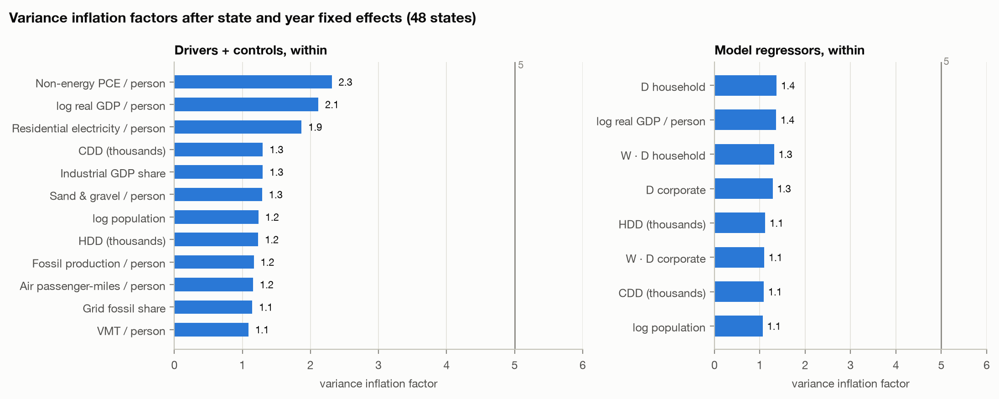
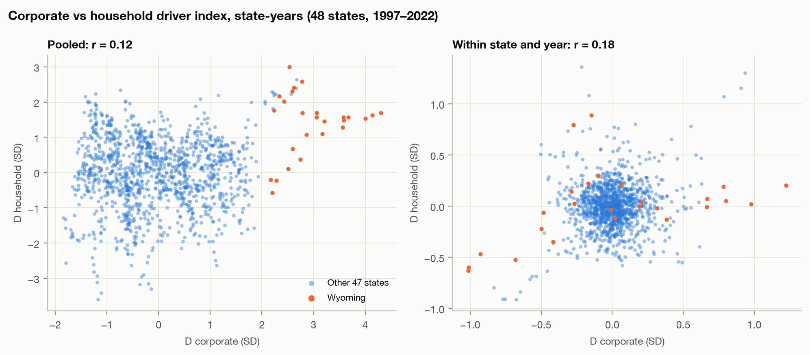
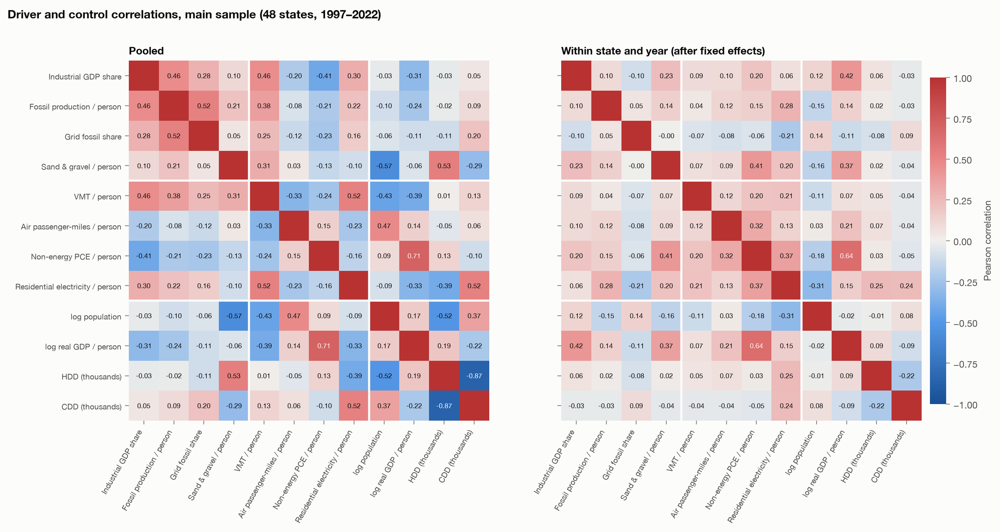
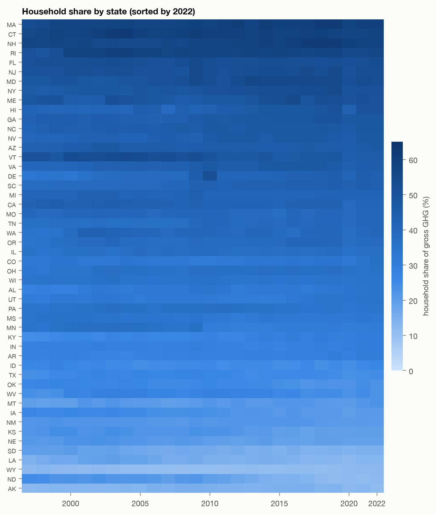
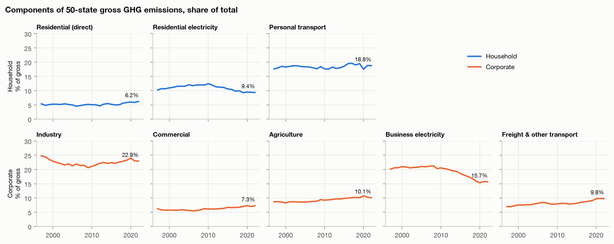
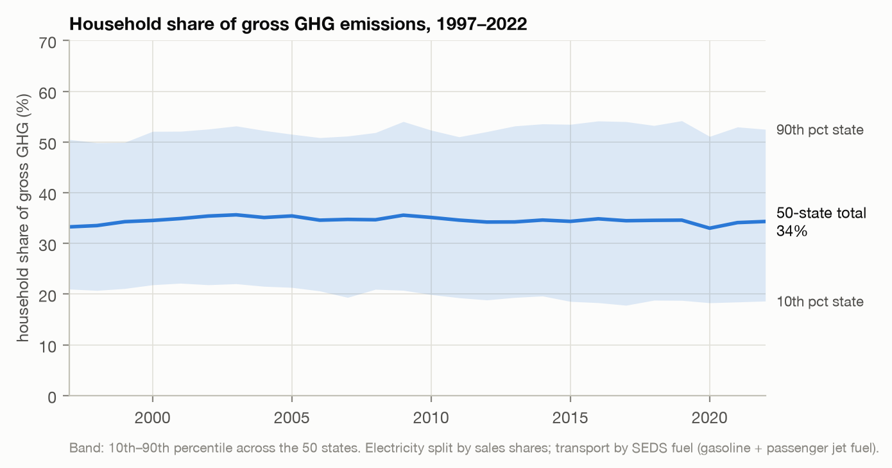

# Phase 3 EDA Review

Review of the six Phase 3 figures in [visuals/](../../visuals/) and the three tables in data/processed/ (correlations.csv, vif.csv, decomposition.csv).

Everything reconciles: the decomposition matches EPA's gross total and every sector exactly. But checking the jumps in the household-share heatmap turned up a real data problem in EPA's figures that needs fixing before the models, so this review starts there.

## Most important finding: three breaks in EPA's iron and steel data

A scan of EPA's raw workbook for one-year jumps that are both large and out of line with each state's normal year-to-year changes found:

| State | Year | Change | Share of state gross |
|---|---|---|---|
| Minnesota | 2010 | Iron and steel 0.08 → 17.57 MMT (lime falls 0.53 → 0.03 the same year) | +12.5% |
| Michigan | 2010 | Iron and steel 2.01 → 12.00 MMT | +4.9% |
| Maryland | 2011–12 | Iron and steel 0.17 → 4.67 → 0.00 MMT | +5.6%, then −6.5% |

2010 is the first year of EPA's facility reporting program (GHGRP). The jumps come from EPA starting to assign iron ore and steel emissions to states differently, not from new steel mills. Maryland's mill (Sparrows Point) really did close in 2012, but the 2011 spike before it isn't real. State fixed effects can't absorb a jump partway through the series, so these would show up as unexplained changes in Y.

The other breaks the scan found are real events and should stay in:

- Delaware's refinery shutting in 2009 and restarting in 2011
- the Mohave coal plant in Nevada closing in 2006
- Washington's aluminum smelters closing in 2001
- new gas plants in New Hampshire (2003) and Maine (2001)
- North Dakota's oil downturn in 2020
- COVID's effect on transportation in 2020

**Recommendation:**
- Add a y_break flag for Minnesota and Michigan from 2010, and for Maryland in 2011–12.
- In the main model, include separate step dummies for those state-years (3 parameters).
- For robustness, rerun with Y excluding industrial process emissions.
- Document all of it in data_sources.md.

## Figure 1: Variance inflation factors (VIF)

**What it shows:** after removing state and year fixed effects, how much each variable is explained by the others. The left panel uses the 12 individual drivers and controls; the right uses the 8 regressors that actually go into the model.

**What it means:**

- Overlap between variables isn't a problem. Every within-state VIF is at most 2.3, and every model regressor is at most 1.4, far under the usual cutoff of 5.
- The highest within-state values are non-energy spending (2.3), log GDP per person (2.1) and residential electricity (1.9). Spending and GDP move together within states (r = 0.64).
- vif.csv also has pooled versions, without fixed effects. There, only HDD (6.9) and CDD (6.2) exceed 5, because cold states have few hot days (pooled r = −0.87). Once fixed effects are in, that drops to 1.2–1.3, so it can be ignored.

**Recommendation:** no change needed for overlap. The GDP–spending link does raise a design question: GDP per person may be partly a result of industrial activity (a mediator), not just a confounder. Holding it fixed could absorb some of the effect being measured. Run one robustness model without the GDP control, and say in the writeup which way you lean.

## Figure 2: Corporate vs. household index scatter

**What it shows:** every state-year, with the raw values on the left and the values after removing fixed effects on the right. Wyoming is highlighted.

**What it means:**

- Raw correlation 0.12, within-state correlation 0.18. The two indices move mostly independently, which is what DML needs to separate their effects.
- On the left, Wyoming sits apart from the other states (corporate index 2.2–4.3 SD). Overlap is otherwise good: across most of the corporate range, there are states at both high and low household values.
- On the right, Wyoming also has the largest within-state swings (from −1.0 to +1.2 on corporate). So it doesn't just stand out in raw levels; it will also pull hard on the fixed-effects and DML estimates.
- There's also a small cluster of points in the lower left (around −0.8, −0.9), plus a few in the upper right, that are worth identifying.

**Recommendation:**
- Beyond leaving out Wyoming, run a leave-one-state-out version: re-estimate 48 times with one state dropped each time, and report the range.
- Find which state-years those outlying within-state points are. If they line up with the breaks above, the step dummies will take care of them.

## Figure 3: Correlation heatmaps

**What it shows:** correlations among all 12 drivers and controls, raw on the left and after fixed effects on the right, with the corporate, household and control blocks separated.

**What it means:**

- Raw correlations mostly reflect differences between states: spending vs. GDP (0.71), HDD vs. CDD (−0.87), sand and gravel vs. population (−0.57, since rural states quarry more per person), VMT vs. residential electricity (0.52), and fossil production vs. grid fossil share (0.52).
- After fixed effects, everything weakens. The largest remaining are spending vs. GDP (0.64), industrial share vs. GDP (0.42), spending vs. sand and gravel (0.41), and spending vs. residential electricity (0.37).
- Importantly, the drivers within each index barely move together once fixed effects are removed. Fossil production vs. grid fossil share is 0.05, and industrial share vs. grid fossil share is −0.10. Each index therefore averages drivers that change independently within a state. That's acceptable for a summary index, but a reviewer could ask whether "corporate activity" is really one thing.

**Recommendation:**
- Report how consistent each index's parts are (Cronbach's alpha, or the loadings on the first principal component).
- Make the one-driver-at-a-time DML a required companion analysis rather than optional. It shows which specific drivers carry each index's effect, and it gives more concrete policy conclusions.

## Figure 4: Household share by state

**What it shows:** each state's household share of gross emissions for each year, sorted by 2022.

**What it means:**

- The order of states is very stable. Northeastern and coastal states (MA, CT, NH, RI, FL, NJ) sit around 55–60%. Energy-producing states (AK, ND, WY, LA) sit around 11–13%.
- Shares mostly come from economic structure, not from household behavior: a state looks "household-heavy" mainly because it has little industry.
- The visible changes over time match the raw data:
  - North Dakota falling from about 30% to 12% (the oil boom, which is real)
  - the Minnesota step down in 2010 (the EPA break)
  - Delaware 2009–2011 (the refinery)
  - Rhode Island 2000 (industrial fuel use dropping from 2.1 to 0.6 MMT; plausible but unconfirmed)
  - Hawaii 2020 (COVID tourism)

**Recommendation:** fine to use as a descriptive figure once the Minnesota and Michigan fix is in. Note in the caption that AK and HI are shown here but aren't in the main model.

## Figure 5: Emission components over time

**What it shows:** each component as a share of 50-state gross emissions, 1997–2022.

**2022 shares:**

| Household | Share | Corporate | Share |
|---|---|---|---|
| Personal transport | 18.8% | Industry | 22.9% |
| Residential electricity | 9.4% | Business electricity | 15.7% |
| Residential direct | 6.2% | Agriculture | 10.1% |
| | | Freight & other transport | 9.8% |
| | | Commercial | 7.3% |
| **Total** | **34.4%** | **Total** | **65.8%** |

**What it means:** both electricity components peaked around 2008–2010 and have been falling as the grid moved from coal to gas and renewables (business electricity went from about 21% to 15.7%). That decline was offset by agriculture, freight and, since 2009, industry growing, which is why the overall household share stays flat. Part of the industry rise after 2010 is the EPA iron and steel artifact.

**Recommendation:** this is the clearest "who emits more" result, and it belongs on a slide: about two-thirds corporate, one-third household. Be upfront that it depends on definitions, and report both versions of the split:

- Moving agriculture to the household side (household_share_ag_hh) raises the average state's household share from 36% to 47%.
- Treating all gasoline as household use slightly overstates the household share, since some is burned by commercial light trucks.

## Figure 6: National household share with a range across states

**What it shows:** the 50-state household share over time, with a shaded band from the 10th to the 90th percentile state.

**What it means:** the national share is very stable (33–36%, 34% in 2022, with a COVID dip in 2020). The band is wide, about 19% to 53%, and the bottom edge has drifted down (from about 21% to 18.5%), meaning energy-producing states are diverging from the rest.

**Recommendation:** this is a good opening figure. It also explains why the causal design depends on within-state changes in drivers, not on changes in the national share: there's very little national movement to work with.

## The three CSVs

**correlations.csv:** 66 pairs (every pair of the 12 variables) × 2 versions (raw and within), matching Figure 3. It doesn't include Y or the two indices. Add them, since each driver's within-state correlation with Y is the most useful row in the table.

**vif.csv:** 4 versions (drivers or model regressors, raw or within), 40 rows. The only values above 5 are HDD and CDD in the raw versions, as described above.

**decomposition.csv:** 19,500 rows (50 states × 26 years × 15 variables). Checks passed:

- Household plus corporate equals EPA gross exactly in every state-year.
- Residential, agriculture, industry and commercial each match EPA's figures exactly, and the electricity and transport splits each add back to EPA's totals.
- No negative values.

Three things to document:

- jet_pax_share is held fixed at its 2003 value for 1997–2002. That's the right way to handle the freight undercount, but write it down.
- The lowest jet passenger shares are Alaska 0.05, Kentucky 0.07 and Tennessee 0.14. That makes sense, because those states host the Anchorage, UPS and FedEx cargo hubs.
- Delaware's share jumps around (1.0 in four years, 0.48 in 2011) because it has so little air traffic. It barely affects the totals, but it's noise.

## What to do next, in order

1. Fix the EPA iron and steel breaks: add flags and step dummies, and add the robustness version of Y without industrial processes. Then rebuild the panel and rerun these figures.
2. Add Y and the indices to correlations.csv, and calculate how consistent each index's parts are.
3. Phase 4 baseline: a fixed-effects regression with standard errors clustered by state. Run four versions: with and without the GDP control, without Wyoming, and with the break dummies. This is the first result DML will be compared against.
4. Phase 5 DML: the two indices first, then each driver on its own.
5. Robustness: leave one state out at a time, and exclude 2020–2021.
